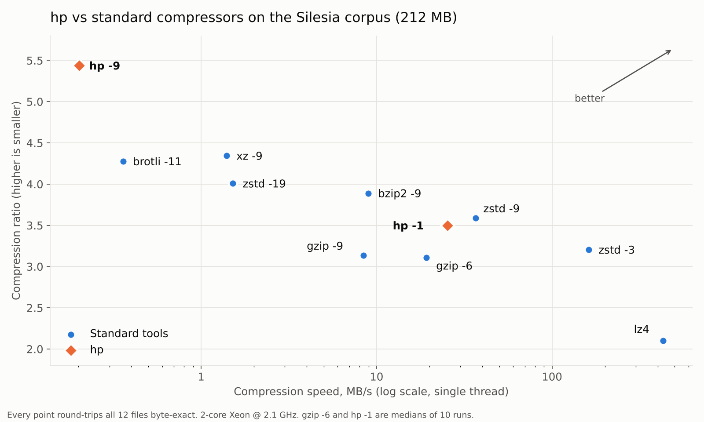

# hp: Pied Piper, actually benchmarked

[](https://github.com/prithsk/pied-piper-hp/actions/workflows/ci.yml) [](LICENSE)

I love HBO's *Silicon Valley*, and Pied Piper is my favorite part of the show. The show never really showed how the compression engine worked, and the famous Weissman scores came with no baseline and no time unit. So I built a real Pied Piper and benchmarked it against the tools Pied Piper would have faced, with every number measured and every file checked.

hp is a lossless compressor in one C file of about 800 lines, and it has no dependencies. It has two modes:

- `hp c -9` is the default. It uses context mixing, and it beats every standard tool I tested on every file. It comes out 20.1% smaller than xz -9 across the whole Silesia corpus, but it is slow.
- `hp c -1` is the fast mode. It uses LZ77 with an adaptive range coder, and it beats gzip -6 on size and on speed at the same time. That means it beats the Weissman baseline even after compression time counts against it.



hp is a fan project. I'm not affiliated with HBO or the show, and Pied Piper, Hooli and Nucleus are their fictional companies.

## Download

Prebuilt binaries are on the [v1.0.0 release](https://github.com/prithsk/pied-piper-weissman/releases/tag/v1.0.0):

- [`hp-linux-x86_64`](https://github.com/prithsk/pied-piper-weissman/releases/download/v1.0.0/hp-linux-x86_64) for Linux, statically linked
- [`hp-windows-x86_64.exe`](https://github.com/prithsk/pied-piper-weissman/releases/download/v1.0.0/hp-windows-x86_64.exe) for 64-bit Windows

I tested both, on Linux and on Windows 11. I built them without `-march=native`, so they run on any x86-64 CPU.

## Pied Piper vs hp

| | Pied Piper in the show | hp |
|---|---|---|
| Algorithm | Middle-out, never shown on screen | Context mixing for `-9`, LZ77 with a range coder for `-1`, all in `hp.c` |
| Test data | One 3D video file at TechCrunch Disrupt | The Silesia corpus: 12 standard files, 211,938,580 bytes |
| Weissman score | 2.89, then 3.8, then 5.2, with no baseline or time unit | 1.274 with time in seconds and 1.161 in milliseconds, both against gzip -6 |
| Proof that it's lossless | The crowd cheered | A SHA-256 match on every file in every run, and a CRC32C inside every `.hp` file |
| Size against real tools | Never stated | 20.1% smaller than xz -9 and 42% smaller than gzip -9 |

The score of 1.274 looks small next to 5.2, but the two numbers can't actually be compared. The show never named its baseline or its time unit, and the formula gives a different answer for each choice. I picked gzip -6 as my baseline, and I report both units. The tables below show the math.

## The tech in the show

- **Middle-out.** Vinith Misra was a PhD student of Stanford professor Tsachy Weissman, and he consulted for the show. He sketched an algorithm that starts in the middle of the data stream and works outward while it hunts for hidden structure. No published algorithm works this way. The closest real thing is Dropbox's Lepton JPEG recompressor, and it predicts pixel values from the middle of a block edge outward.
- **The Weissman score.** Misra wrote this formula for the season 1 finale:

  `W = α · (r / r̄) · (log T̄ / log T)`

  The letter r stands for compression ratio, T stands for compression time, and the bars mark the baseline compressor. I use α = 1.
- **The numbers.** Hooli's Nucleus and Pied Piper both score 2.89 at TechCrunch Disrupt. Richard rewrites the platform overnight and reaches 3.8. Then a judge hands him a 3D video file, and Pied Piper scores a record 5.2.

The Weissman score is pretty broken as a metric. The score changes when the time unit changes. It hits zero or infinity at T = 1, and it goes negative for runs shorter than one unit. In my tables, lz4 scores -2.30 with time in seconds, and zstd -3 scores 9.24. That ranking only reflects the log of the time. So I report W, but I base my claims on tests that hold in any unit.

## How I verified it

1. **The hard gate.** Every file has to decompress byte-for-byte identical, and SHA-256 checks it. One mismatch fails the whole run. Both modes pass on all 12 Silesia files.
2. **Beating the baseline with time counted.** hp -1 has to come out smaller than gzip -6, and it also has to compress faster on every one of 10 interleaved timing runs. This test holds in any time unit, and it implies a Weissman score above 1 whenever both times exceed one unit.
3. **Size.** I compare total compressed size against gzip, bzip2, xz, zstd and brotli at strong settings.

`bench.py` runs the gate and the size tables. `timing.py` runs the repeated head-to-head timing. `report.py` builds the tables from `results.json`.

## Beating the baseline with time counted

I ran `timing.py` for 10 interleaved runs over all of Silesia. Each run used a single thread on a 2-core Xeon at 2.1 GHz, and each run also did the round-trip check.

| | Size in bytes | Ratio | Compress time, median, min to max | Decompress, median | Weissman, seconds | Weissman, ms |
|---|---:|---:|---:|---:|---:|---:|
| gzip -6, the baseline | 68,227,893 | 3.106 | 11.03 s, 10.64 to 11.35 | 2.01 s | 1.000 | 1.000 |
| **hp -1** | **60,577,196** | **3.499** | **8.35 s, 7.73 to 8.58** | 4.93 s | **1.274** | **1.161** |

The slowest hp -1 run beat the fastest gzip -6 run by 19%, and the hp -1 output is 11.2% smaller. hp -1 wins on 11 of the 12 files. The one loss is `reymont`, a Polish text file, where hp -1 comes out 5% larger than gzip -6. hp -1 also decompresses about 2.5x slower than gzip. The Weissman score ignores decompression, but real users don't.

### Second machine

I repeated the head-to-head on an Intel Core Ultra 9 285H laptop under WSL2 on Windows. The laptop was running warm and throttled, and its times are about twice as slow as an earlier unthrottled run.

hp -1 came out 11.2% smaller than gzip -6, and it compressed faster in all 10 interleaved runs. Its median was 10.56 s, against 11.77 s for gzip -6. The strict test still **failed** on this machine: hp -1 ranged from 8.35 to 12.35 s, so its slowest run lost to gzip -6's fastest run of 10.41 s. Run-to-run noise was bigger than the gap between the two tools. The test passed on the 2-core VM above, and that table stays the main result. hp -1 won 10 of 10 paired runs. If the two tools were equally fast, that would happen by chance about 1 time in 1,024.

The laptop's raw numbers are in `results_laptop.json`, a full one-pass benchmark from an earlier unthrottled run, and `timing_laptop.json`, the throttled 10-run head-to-head above.

## Where hp really stands

hp -9 is the real headline. It beats every tool I tested on every file, and the next section shows each one.

hp -1 beats gzip, but zstd already sits ahead of hp -1. zstd -9 makes 59,081,628 bytes at 36.6 MB/s on the same corpus through the same round-trip harness. That result is smaller and faster than hp -1, so I don't claim hp -1 beats modern tools. zstd has years of tuning behind it, and closing that gap is my next fight. The chart shows zstd -9 just up and to the right of hp -1.

hp -9 also isn't the strongest compressor in the world. cmix publishes 28,261,094 bytes for Silesia on its own site, so hp -9 comes out about 38% larger than cmix. cmix recommends at least 32 GB of RAM and runs far slower still, and hp -9 needs about 1.1 GB. I tried to measure paq8px myself, but my build sandbox blocked running downloaded third-party code, so I left it out of the tables.

## All results

I ran each tool once for this table. xz -9, zstd -19 and brotli -11 shared the 2-core machine with other jobs during their runs, so their speeds may read a little low. The head-to-head table above is my clean measurement.

| Compressor | Silesia size in bytes | Ratio | vs xz -9 | Compress MB/s | Decompress MB/s | Weissman, seconds | Weissman, ms | Round trip |
|---|---:|---:|---:|---:|---:|---:|---:|---|
| lz4 default | 100,914,799 | 2.100 | +106.8% | 430.38 | 1432.14 | -2.30 | 1.02 | 12/12 exact |
| zstd -3 | 66,137,723 | 3.205 | +35.5% | 161.97 | 633.92 | 9.24 | 1.34 | 12/12 exact |
| gzip -6 | 68,227,893 | 3.106 | +39.8% | 19.05 | 105.10 | 1.00 | 1.00 | 12/12 exact |
| gzip -9 | 67,631,918 | 3.134 | +38.6% | 8.42 | 106.32 | 0.75 | 0.93 | 12/12 exact |
| **hp -1, fast** | 60,577,196 | 3.499 | +24.1% | 26.13 | 43.77 | 1.30 | 1.17 | 12/12 exact |
| zstd -9 | 59,081,628 | 3.587 | +21.1% | 36.63 | 534.41 | 1.58 | 1.24 | 12/12 exact |
| bzip2 -9 | 54,506,769 | 3.888 | +11.7% | 8.97 | 20.51 | 0.95 | 1.16 | 12/12 exact |
| zstd -19 | 52,891,946 | 4.007 | +8.4% | 1.52 | 478.88 | 0.63 | 1.01 | 12/12 exact |
| brotli -11, 24-bit window | 49,564,563 | 4.276 | +1.6% | 0.36 | 233.59 | 0.52 | 0.97 | 12/12 exact |
| xz -9 | 48,795,480 | 4.343 | +0.0% | 1.40 | 47.44 | 0.67 | 1.09 | 12/12 exact |
| **hp -9, best** | **38,982,429** | **5.437** | **-20.1%** | 0.20 | 0.20 | 0.61 | 1.18 | 12/12 exact |

Compressed bytes per file:

| File | Original | gzip -6 | hp -1 | gzip -9 | bzip2 -9 | zstd -19 | brotli -11 | xz -9 | hp -9 | hp -9 vs best other |
|---|---:|---:|---:|---:|---:|---:|---:|---:|---:|---:|
| dickens | 10,192,446 | 3,868,770 | 3,779,435 | 3,851,815 | 2,799,520 | 2,849,941 | 2,827,777 | 2,830,604 | 2,154,226 | -23.1% |
| mozilla | 51,220,480 | 19,048,737 | 15,914,349 | 18,994,134 | 17,914,392 | 15,065,760 | 13,872,265 | 13,374,160 | 11,627,688 | -13.1% |
| mr | 9,970,564 | 3,690,569 | 3,075,331 | 3,673,937 | 2,441,280 | 3,107,144 | 2,823,136 | 2,750,272 | 2,140,407 | -12.3% |
| nci | 33,553,445 | 3,199,449 | 2,807,072 | 2,987,529 | 1,812,734 | 1,664,984 | 1,519,768 | 1,738,884 | 1,387,489 | -8.7% |
| ooffice | 6,152,192 | 3,097,073 | 2,487,741 | 3,090,434 | 2,862,526 | 2,595,003 | 2,478,855 | 2,426,816 | 1,716,537 | -29.3% |
| osdb | 10,085,684 | 3,739,573 | 3,394,870 | 3,716,337 | 2,802,792 | 3,100,173 | 2,816,278 | 2,849,908 | 2,240,603 | -20.1% |
| reymont | 6,627,202 | 1,858,621 | 1,954,405 | 1,820,826 | 1,246,230 | 1,348,458 | 1,332,158 | 1,317,152 | 931,054 | -25.3% |
| samba | 21,606,400 | 5,460,531 | 4,713,538 | 5,408,266 | 4,549,759 | 3,897,788 | 3,766,340 | 3,763,616 | 3,052,924 | -18.9% |
| sao | 7,251,944 | 5,332,822 | 5,134,855 | 5,327,037 | 4,940,524 | 5,000,572 | 4,586,092 | 4,415,072 | 3,899,954 | -11.7% |
| webster | 41,458,703 | 12,201,972 | 11,669,662 | 12,061,616 | 8,644,714 | 8,679,359 | 8,428,575 | 8,385,868 | 5,842,977 | -30.3% |
| x-ray | 8,474,240 | 6,037,788 | 5,016,560 | 6,037,707 | 4,051,112 | 5,129,823 | 4,682,753 | 4,489,868 | 3,660,131 | -9.7% |
| xml | 5,345,280 | 691,988 | 629,378 | 662,280 | 441,186 | 452,941 | 430,566 | 453,260 | 328,439 | -23.7% |

## Is it actually middle-out?

No, it isn't. The show never defined middle-out well enough for anyone to build it, and a compressor that starts in the middle of a stream has no clear advantage, since every byte still has to be coded once. hp just reads the data from front to back. The context mixer does chase the same goal Misra described, though. It looks at the data from many angles at once and bets on whichever pattern predicts the next bit best. I feel that this is the closest honest thing to Richard's whiteboard.

## Security review

I reviewed the code and found these issues. All of them are fixed now.

| Issue | Risk | Fix |
|---|---|---|
| The output file opened before hp read the input | `hp c f f` truncated `f` to zero bytes and destroyed it | hp refuses when the input and output are the same file, and it writes output only after the whole job succeeds |
| No integrity check | A corrupt `.hp` file decoded to silent garbage | The header stores a CRC32C of the original. The decoder checks it and the exact stream length before it writes anything, and corrupt input exits with code 2 |
| The header size came from `getc` with no EOF check | A short file produced a garbage size and an unchecked `malloc` | hp reads the whole file first and then validates the header. Every allocation is checked |
| Sizes over 4 GB got cut to 32 bits | Data loss on a round trip | hp rejects inputs over 4 GB |
| The header set the model table size up to 26 bits | A crafted file could ask for 4 GB of model memory | The table size is limited to 16 through 24 bits |
| `HP_*` experiment variables changed the decoder | A different environment at decode time gave wrong output | The release build ignores them, and old versions stay in `experiments/` |
| The LZ decoder copies from a coded distance | An out-of-bounds read or write on crafted input | The decoder checks every distance and length against the output so far, and the range decoder checks its input bounds |
| Mixer weights could grow without bound | Signed overflow is undefined behavior in C | Weights are clamped to ±2^24. On Silesia the clamp changes only `nci`, and that stream gets 32 bytes smaller |
| `fwrite` and `fclose` errors went unchecked | A full disk gave silently truncated output | hp checks them and deletes a partial output |
| Scripts used fixed `/tmp` names | A symlink race on shared machines | `rt.sh` uses `mktemp -d` now, and `bench.py` already used `tempfile` |
| Windows reports every file's inode as 0 | The same-file guard refused every file, so `hp c` never worked on Windows | On Windows, hp compares the volume serial number and file index through the Win32 API. I tested it on Windows 11 |
| `long` is 32 bits on Windows | The x86 filter's lengths could wrap for files from 2 to 4 GB | The lengths are `int64_t` now. Linux output is byte-identical before and after the change |

The byte-exact gate also caught a real bug in the fast mode while I tuned it. The parser skips ahead inside long runs of literals, and that skip could leave a stale lookahead match behind. The encoder then wrote that match at the wrong position. The CRC rejected the output before hp wrote anything.

**Fuzzing.** `fuzz.py` mutates valid `.hp` files with bit flips, byte overwrites, truncation, appended junk, splices and header edits. It also builds random streams behind valid-looking headers. Every case runs through both decoders in a build with AddressSanitizer and UndefinedBehaviorSanitizer.

- The first pass ran 3,000 cases. 2,807 were rejected, and 193 were accepted with output identical to the original. There were no crashes, no sanitizer reports, no hangs and no wrong outputs accepted.
- The final code ran the same 3,000 mutations with seed 1234, and the outcome was identical.
- The final code also ran 2,000 new mutations with seed 777. 1,870 were rejected, and 130 were accepted with identical output. There were no crashes, no sanitizer reports, no hangs and no wrong outputs accepted.
- CI runs `scripts/ci_check.sh` on every push and once a week. It round-trips both modes, checks that corrupt input gets rejected with no output, checks the same-file guard and fuzzes 300 more cases under the sanitizers.

The accepted mutations changed no decoded byte. Some edited the coder's padding bytes, and others edited the table-size byte, a field the fast mode doesn't use. Both encoders also ran under the sanitizers on all 12 sample files. GCC's static analyzer with `-fanalyzer` reported nothing. The hardware CRC32C path and the portable table path give identical results, so `.hp` files move between machines.

**What remains open.**

- CRC32C catches corruption, but it can't catch tampering. Anyone can build a valid `.hp` file.
- Decompression allocates the size in the header, up to 4 GB. A tiny file can legitimately expand to 4 GB with any compressor, so untrusted input should run under a memory limit like `ulimit -v`.
- hp -9 needs about 1.1 GB for its model.

## How hp -1 works

hp -1 feeds an LZ77 parser into an adaptive binary range coder. It belongs to the LZMA family, but I wrote my own simpler version.

- **Match finder.** A 4-byte hash table holds 2^18 buckets of 4 recent positions. The table takes 4 MB, so it stays mostly in cache. hp prefetches the next position's bucket while it codes the current one, and that cut CPU time by 15% to 20% on my test machine. The window covers the whole file.
- **Parser.** The parser takes a greedy match with one step of lazy lookahead. It prefers a repeat of the last distance when that match is nearly as long. It skips a 4-byte match farther than 64 KB, since the distance bits cost more than the match saves. Inside long runs of incompressible bytes, it only probes every 4th position.
- **Coding.** Literals use the top 3 bits of the previous byte as context. After a match, the next literal gets coded against the byte at the old match distance. Lengths use a 3-tier code, and distances use a slot code with modeled low bits. All probabilities are 11-bit adaptive counters.
- **x86 filter.** Files that look like x86 code get the E8/E9 call-address transform first, in both modes. In Silesia, only `ooffice` triggers it.

## How hp -9 works

hp -9 codes every byte as 8 binary decisions. For each bit:

1. **16 hashed contexts** predict the bit. They cover orders 2 through 8, two word contexts for text, four sparse contexts for binary data, a high-nibble context and three record contexts. The record contexts find fixed-width rows on their own, and that helps with tables and images. Each context points into a shared 1 GB hash table of 64-byte slots. Each slot holds one nibble, a checksum and a 2-way replacement policy.
2. Each slot entry holds an adaptive probability with a capped hit count. It also stores the last bit and the run length seen in that context, and both feed the mixer.
3. **A match model** finds the last spot where the previous 6 or more bytes appeared, and it predicts the byte that came next.
4. **Three logistic mixers** combine about 36 inputs. They pick weight sets by the partial byte, by the match state and by the byte two back. A small final mixer blends their outputs.
5. **Three SSE stages** refine the result with order-0, order-1 and order-2 context.
6. A 32-bit binary arithmetic coder writes the bits.

## Ablations

I ran these on a 12 MB sample made from the first 1 MB of each Silesia file. On this sample, xz -9e makes 3,981,316 bytes.

| Version | Change | Bytes | Step |
|---|---|---:|---:|
| v1 | orders 2-8, word, sparse, match, 2 mixers, 3 SSE | 3,480,022 | |
| v2 | record model, x86 filter, faster counter adaptation, mixer rate 10 | 3,339,803 | -4.0% |
| v3 | run-length input per context, one dead context removed | 3,320,850 | -0.6% |
| v4 | third mixer and a final mixing layer | 3,290,245 | -0.9% |
| v5 | 4x larger hash table at 1 GB, table size in the header | full corpus only | -1.2% on 16 MB of webster |

I also turned off one v1 part at a time to see which parts really carry weight:

| Removed | Cost |
|---|---:|
| match model | +1.63% |
| second mixer | +1.37% |
| SSE stages | +0.84% |
| order 2 | +0.57% |
| order 3 | +0.39% |
| high-nibble context | +0.36% |
| direct order 1 | +0.26% |
| word + previous word | +0.18% |
| any single order 4-8 or sparse context | +0.02% to +0.16% |
| word + last byte | 0.00%, so I removed it in v3 |

Each single context adds pretty little because the contexts overlap. The match model and the mixer structure matter most.

For the fast mode, I tuned on the full corpus with `experiments/tools/lzgrid.sh` and `lzcpu.py`. A larger hash table or more ways improved size by up to 2.3%, but each one cost about 20% to 25% in speed because the table fell out of cache. Prefetching gave the biggest speed gain. Profile-guided optimization gave nothing I could measure.

## Limits

- hp -9 runs at about 0.2 MB/s in each direction. That makes it about 7x slower than xz -9 to compress and about 225x slower to decompress. It needs about 1.1 GB of RAM plus twice the file size.
- hp -1 decompresses at about 43 MB/s, and gzip runs 2.5x faster.
- hp runs on a single thread, and every timing here is single-thread.
- Stronger context-mixing compressors exist. paq8px and cmix beat hp -9 on size, but they run 10x to 100x slower still.
- The file format is version `HP3`, and files from my earlier experiment builds won't decode.

## Usage

The whole benchmark is one command on Linux, macOS or WSL. It builds hp, downloads Silesia from a GitHub mirror, checks every file by SHA-256 and then reruns every table and the chart:

```
pip install zstandard brotli lz4 matplotlib
bash scripts/bench_all.sh
```

To run hp by hand:

```
gcc -O3 -march=native -o hp hp.c
./hp c -1 input output.hp      # fast
./hp c input output.hp         # best, same as -9
./hp d output.hp restored      # either mode; exits 2 on corrupt input

bash scripts/get_silesia.sh corpus/silesia
python3 bench.py corpus/silesia gzip6,hp1,hp --out results.json
python3 timing.py corpus/silesia 10 gzip6,hp1
python3 report.py results.json
python3 chart.py

bash scripts/ci_check.sh 300   # the same checks CI runs
```

On Windows, the release binary works the same way in PowerShell:

```
.\hp-windows-x86_64.exe c -1 input output.hp    # fast
.\hp-windows-x86_64.exe c input output.hp       # best, same as -9
.\hp-windows-x86_64.exe d output.hp restored    # either mode; exits 2 on corrupt input
```

## What's in the repo

| Path | What it holds |
|---|---|
| `hp.c` | the whole compressor, both modes |
| `bench.py`, `timing.py`, `report.py`, `chart.py` | the benchmark harness, the repeated timing, the tables and the chart |
| `fuzz.py` | the mutation fuzzer for both decoders |
| `scripts/` | the corpus downloader, the one-command benchmark and the CI check |
| `results.json`, `timing.json` | the raw numbers behind every table here |
| `results_laptop.json`, `timing_laptop.json` | the second-machine data from the Core Ultra 9 285H laptop |
| `experiments/` | every earlier version's source, the benchmark and fuzz logs and the tuning scripts |

## License

hp is MIT licensed. See [LICENSE](LICENSE).

## Sources for the show details

- [Weissman score, Wikipedia](https://en.wikipedia.org/wiki/Weissman_score)
- [Optimal Tip-to-Tip Efficiency, Wikipedia](https://en.wikipedia.org/wiki/Optimal_Tip-to-Tip_Efficiency)
- [A Made-for-TV Compression Algorithm, IEEE Spectrum](https://spectrum.ieee.org/a-madefortv-compression-algorithm)
- [Q&A with Stanford faculty on Silicon Valley, Stanford News](https://news.stanford.edu/2019/12/16/qa-stanford-faculty-silicon-valley/)
- [Dropbox's Lepton uses a middle-out algorithm, TechCrunch](https://techcrunch.com/?p=1353288)
- [Silesia corpus mirror on GitHub](https://github.com/MiloszKrajewski/SilesiaCorpus)
